# Việt hóa Where Winds Meet server Trung | Việt hóa Yến Vân server Trung
Bản Việt hóa Where Winds Meet | Yến Vân Thập Lục Thanh bản Trung (yysls.cn)

Từ phiên bản 2.1.0 Hỗ trợ cả bản Quốc tế (Global)

Chức năng:
- Dịch toàn bộ văn bản trích xuất từ file "translate_words_map_zh_cn", chất lượng bản dịch cao
- Custom font
- Fix hoàn toàn lỗi fallback về tiếng Trung với hội thoại
- Dịch bổ sung thêm các text hotfix chưa có trong file words_map (sự kiện, vật phẩm, map, nhiệm vụ mới...)
- Đồng bộ xưng hô cổ phong, dịch sát nghĩa, dễ hiểu...
- Hệ thống danh hiệu, địa danh, môn phái, chiêu thức... Hán-Việt đậm chất cổ phong
- Sửa rất rất nhiều lỗi dịch thuật.
- Hệ thống tự động cập nhật toàn diện các bản dịch bổ sung, cập nhật mới với cả bản PC và android

Hướng dẫn tải và cài đặt
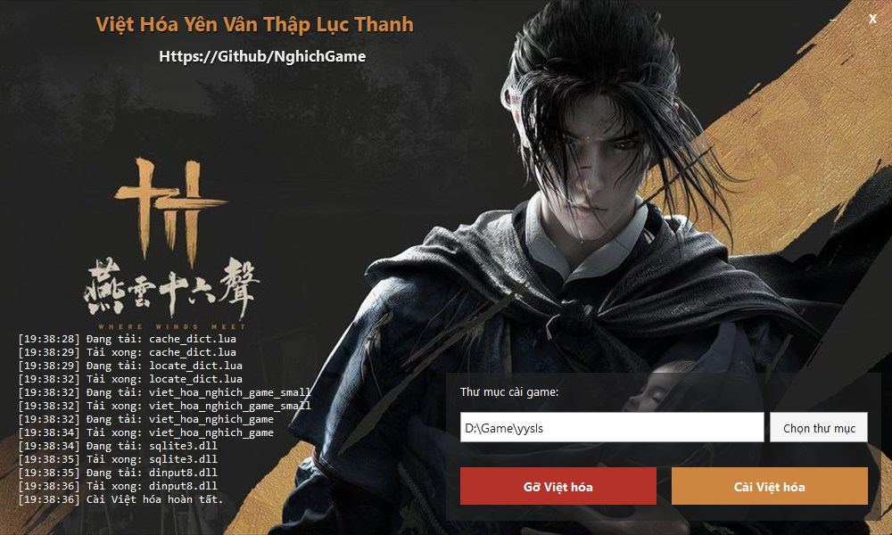

Cài đặt riêng cho bản Quốc tế (Global)
- Trong cài đặt ngôn ngữ của game, cần tải và chọn ngôn ngữ "Tiếng Trung giản thể" (Để đồng bộ với bản Trung hiện tại)
- Ngôn ngữ giọng nói -> tùy chọn
- Mục tiêu dịch: Chọn tiếng Việt
- Bản dịch global dùng dung bản dịch với bản Trung, bổ sung thêm ~12k text riêng của global.
- Sau khi làm các bước này, thoát game và làm theo hướng dẫn chung bên dưới
- Về kênh chat, sau khi cài Việt hóa, sẽ tự động chuyển kênh thế giới mặc định về kênh Tiếng Việt 1
- Về một số mini game cần nhập liệu như: viết câu đối, viết đáp án, có thể cần tạm thời chuyển sang tiếng Việt gốc của game để làm. Thường xuất hiện ở mini game Diệu Diệu Miêu, và 1 số mini game nhỏ ở Thanh Châu, Giang Nam, Vị Ương thành...

PC:
- tải file việt hóa mới nhất (VietHoa_WWM_NghichGame_PC_xxx.zip) tại [ĐÂY](https://github.com/NghichGame/yysls-cn-vn/releases/)  hoặc bấm vào page release.
- Sau khi tải về Giải nén ra sẽ có 2 file VietHoa_WWM_NghichGame.exe và SQLite.Interop.dll, Chạy file VietHoa_WWM_NghichGame.exe để mở app Việt hóa.
- Ở mục đường dẫn game, ấn chọn thư mục và chọn đúng đường dẫn game, ví dụ "D:\Games\yysls\". Lưu ý không phải thư mục "yysls_medium" hay "yysls_fast" như từ phiên bản 2.0.8 trở về trước.
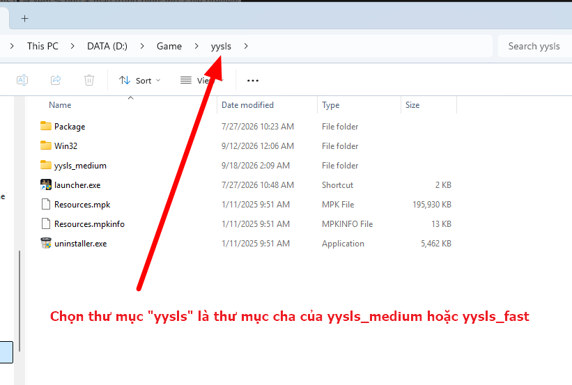
- Sau khi chọn đúng thư mục cài game, App sẽ báo đã tìm thấy thư mục LocalData là ok. Bấm "Cài Việt hóa" và đợi app cài báo thành công.
- Lưu ý: Một số trường hợp game nằm ở ổ C, cần ấn chuột phải vào App Việt hóa, chọn "Run As Administrator" để app có quyền ghi file. Trường hợp đã chạy với quyền Admin vẫn không thể ghi file, bắt buộc phải chuyển game sang ổ D hoặc E (Không phải ổ cài win).

GỠ Việt Hóa: Ấn "Gỡ Việt hóa" trên app (Cần chọn đúng phiên bản CN hay Global).

Sửa lỗi:
- Trường hợp game cập nhật vào game lần đầu vị chuyển về tiếng trung (thường xảy ra nếu lâu không vào game). chỉ cần thoát game, vào lại game lần nữa.
- Trường hợp như trên vẫn không được =>Ấn Gỡ Việt hóa ở App. chạy game 1 lần để game làm mới dữ liệu. Sau đó ấn cài lại Việt hóa và chạy lại game.

Android:
- tải file VietHoa_WWM_NghichGame_xxx.apk tại [ĐÂY](https://github.com/NghichGame/yysls-cn-vn/releases/) về máy và cài đặt.
- Cài apk xong Xem video hướng dẫn cài đặt chi tiết tại [ĐÂY](https://www.youtube.com/watch?v=b2jF4ASrIW4)
- Từ phiển bản App 2.1.0 cần chọn đúng bản Trung, Global hoặc Funtap
- Sửa lỗi: nếu khi game cập nhật chữ bị chuyển về tiếng trung. Mở app Việt hóa, ấn Cài việt hóa, hoặc ấn Chạy Game trong app Việt hóa, app sẽ tự động cập nhật Patch hotfix mới nhất.
- Trường hợp làm như trên vẫn lỗi, ấn Gỡ Việt hóa, chạy game 1 lần để game tạo lại data, sau đó ấn Cài Việt hóa lại.
- Từ phiên bản App 2.0.3 android đã có cập nhật tự động toàn diện, cập nhật tự động mỗi khi game chạy.

Cập nhật:
- Dự án dịch cập nhật mới liên tục, thường từ vài tiếng tới 2 ngày sau khi game cập nhật, tùy vào bản cập nhật của game lớn hay nhỏ. Ví dụ (với bản Trung) bản cập nhật lớn, như ra map mới, số lượng text trong mỗi bản cập nhật có thể lên tới 30k dòng, để dịch và sửa lỗi tương đối ổn có thể cần tới 2 ngày. Thường mình sẽ dịch sơ bộ và cập nhật ngay trong vài tiếng sau khi game cập nhật, sau đó sửa và điều chỉnh dần trong 1 2 ngày sau đó. Nếu muốn có trải nghiệm cốt truyện tốt nhất, mn có thể chờ khoảng 2 ngày sau khi game cập nhật mới làm các nhiệm vụ cốt truyện có thể trải nghiệm chất lượng bản dịch tốt nhất. Với bản global, vì đa số cốt truyện ra sau bản Trung, đã được dịch từ trước nên không cần chờ.
- Dự án sẽ cố gắng cập nhật, sửa lỗi dịch thuật nhiều nhất có thể
- Chi tiết các bản cập nhật xem ở page release

Hạn chế:
- Vì khối lượng văn bản lớn, bản dịch không thể tránh các sai sót chưa thể sửa lỗi

Liên hệ:
- Mọi vấn đề về lỗi hoặc vấn đề liên quan cần hỗ trợ vui lòng liên hệ zalo: 0386565646

 [Video demo 1](https://youtu.be/TWB9fqID1Qc), [video demo2](https://youtu.be/8YXyXx1DwKM)

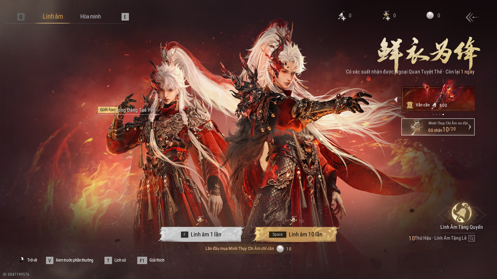
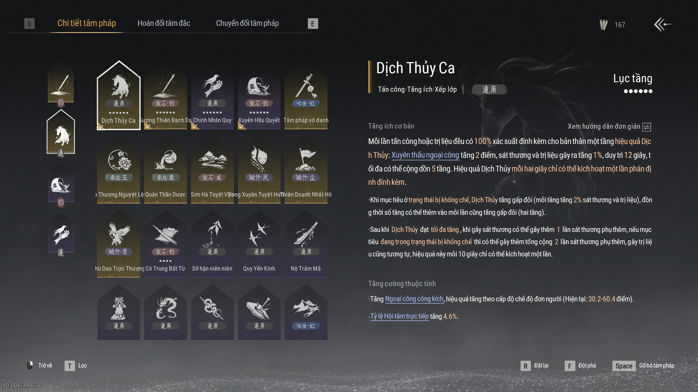

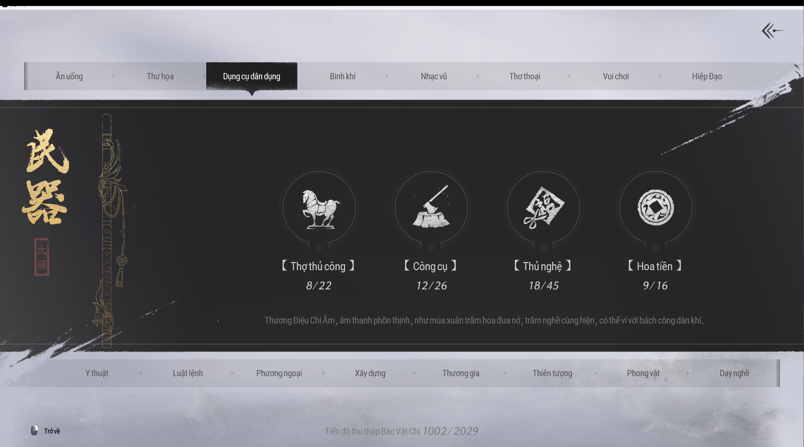
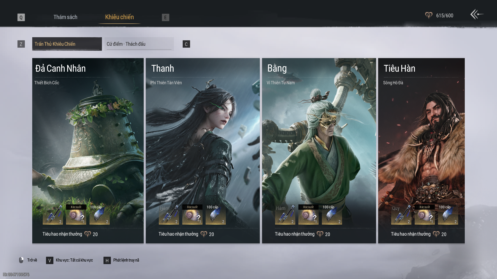
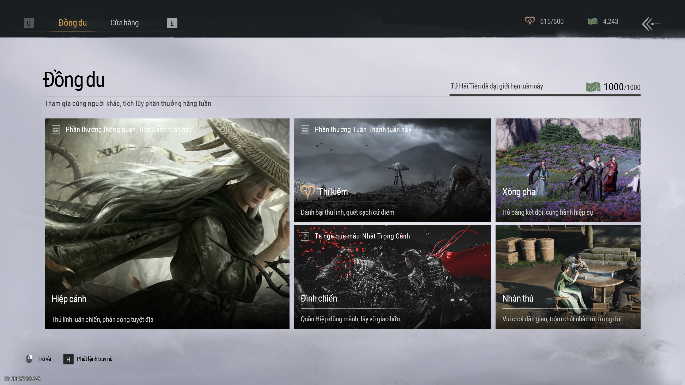
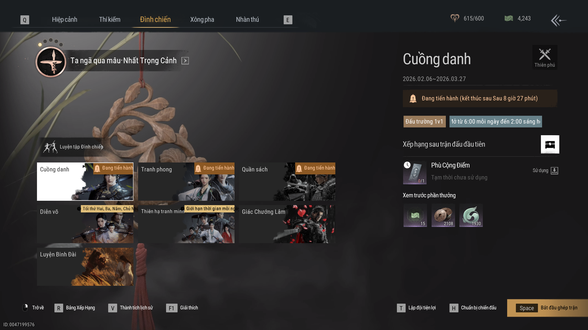
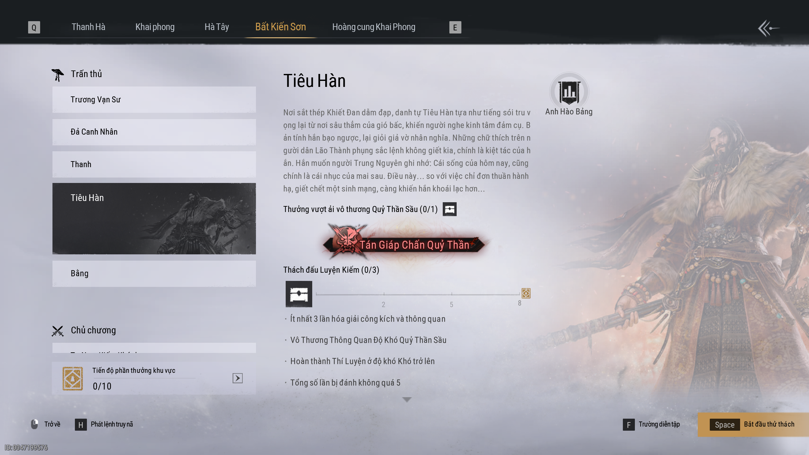
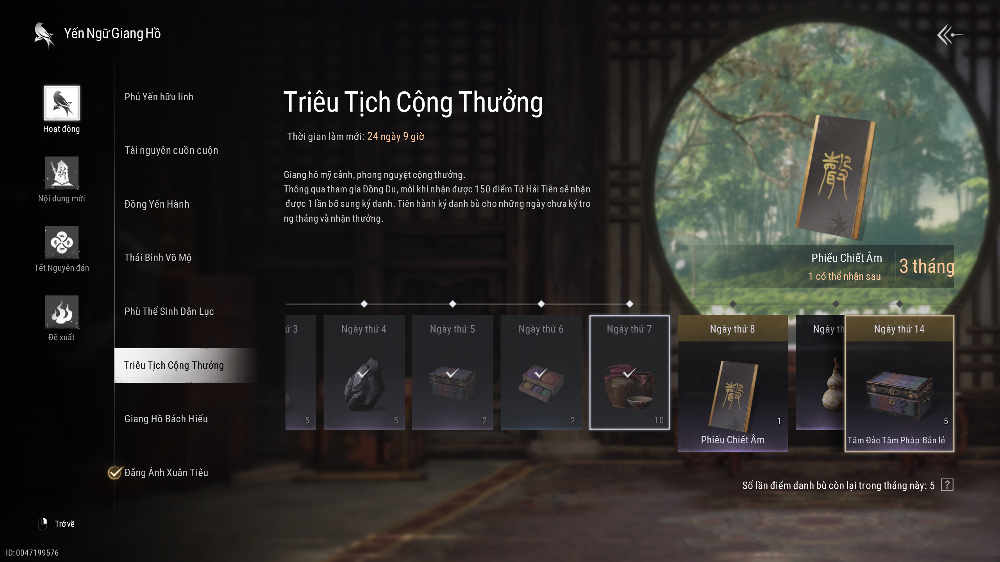
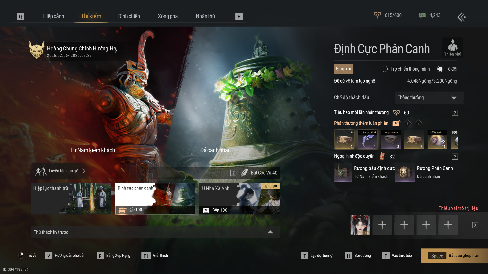
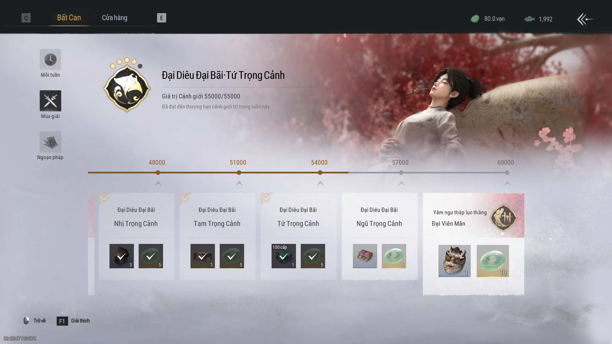

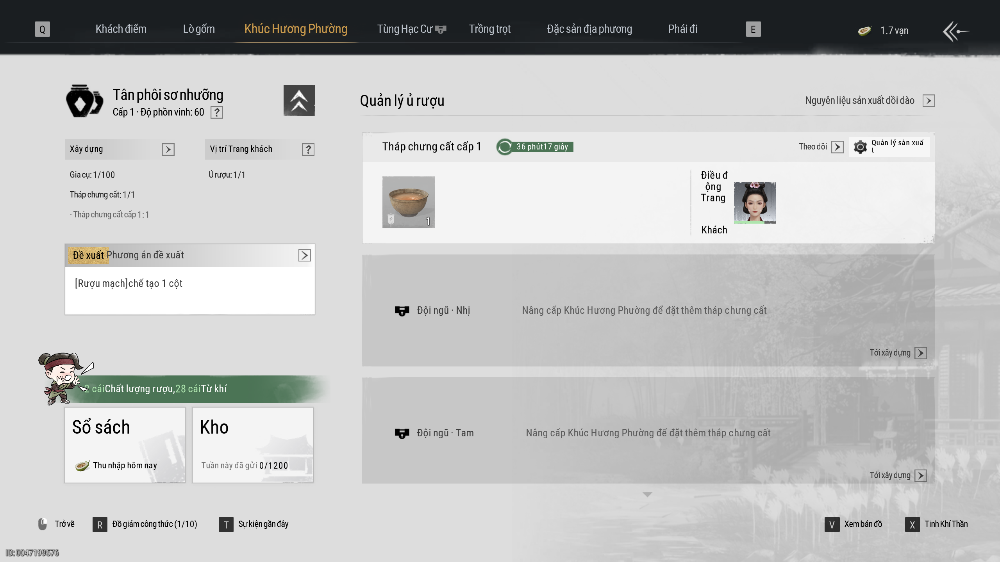

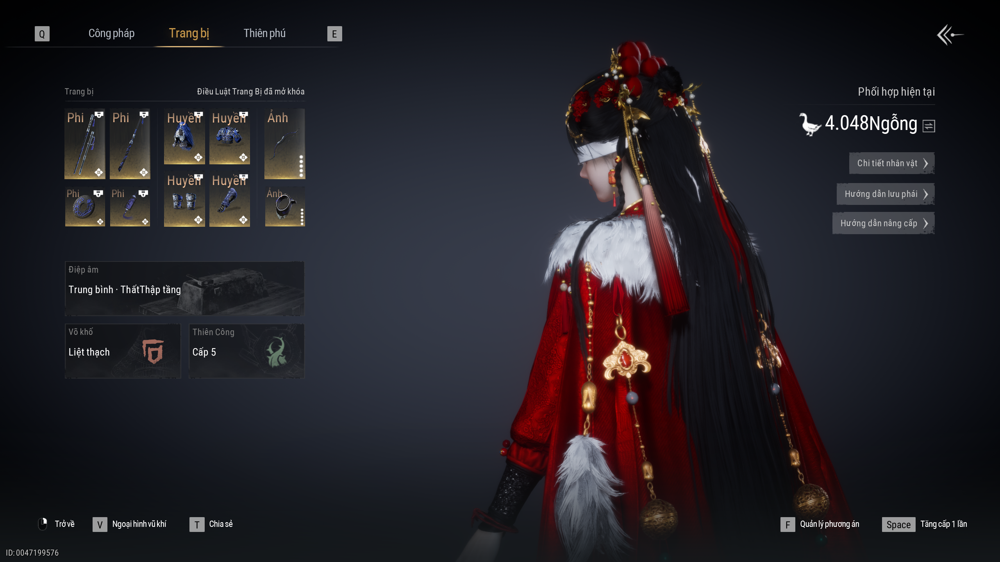
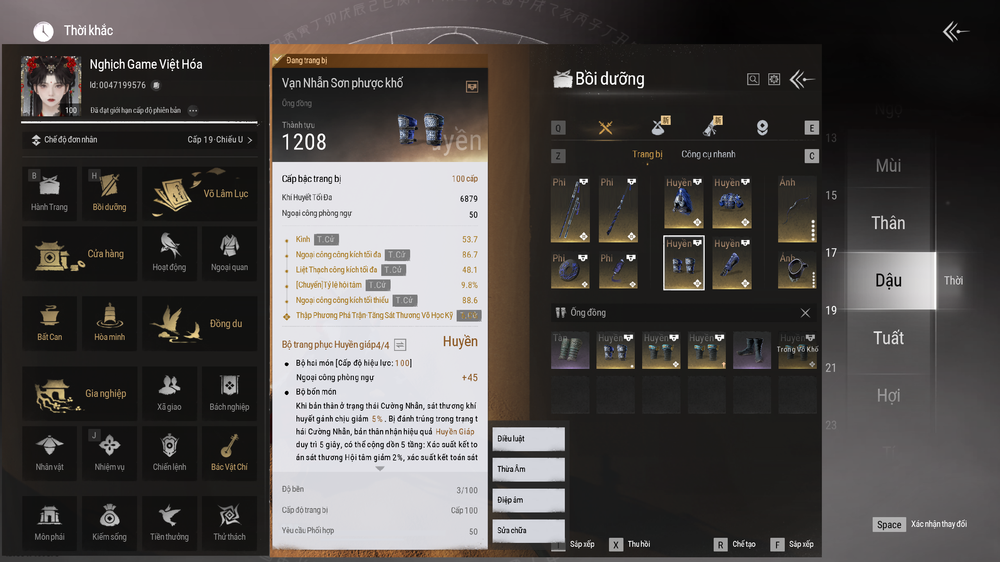
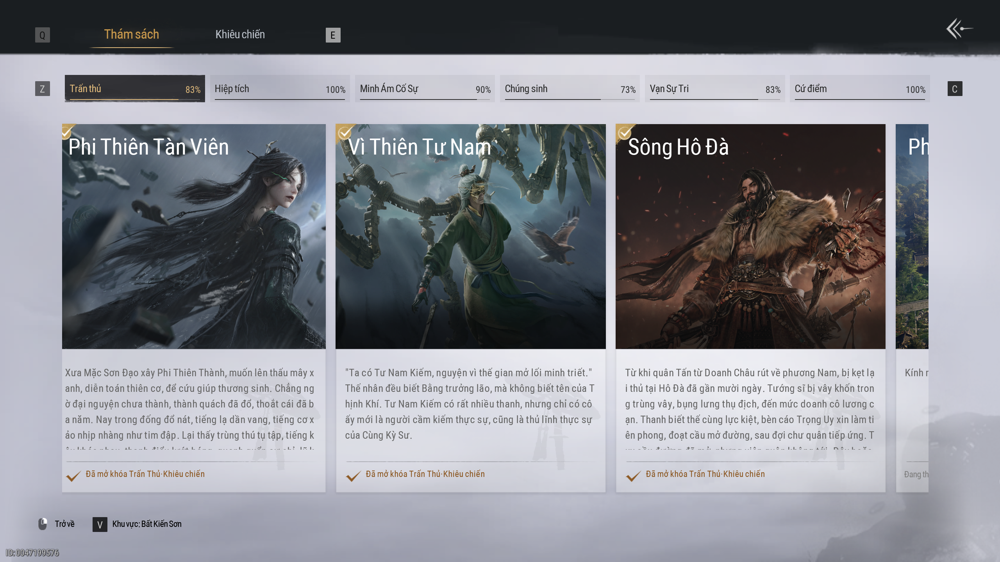
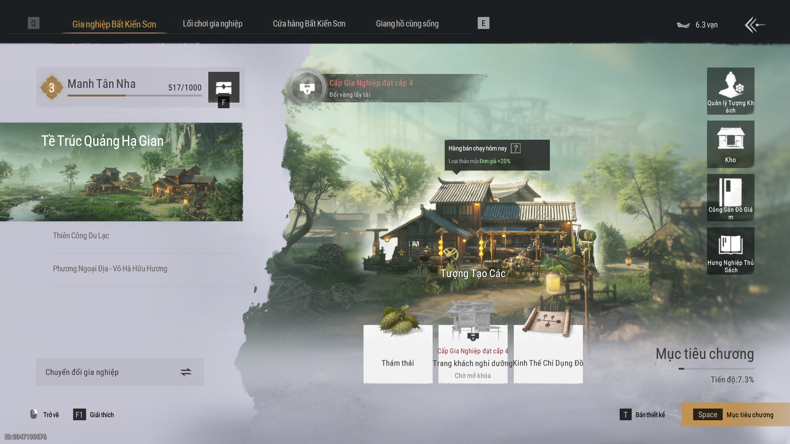
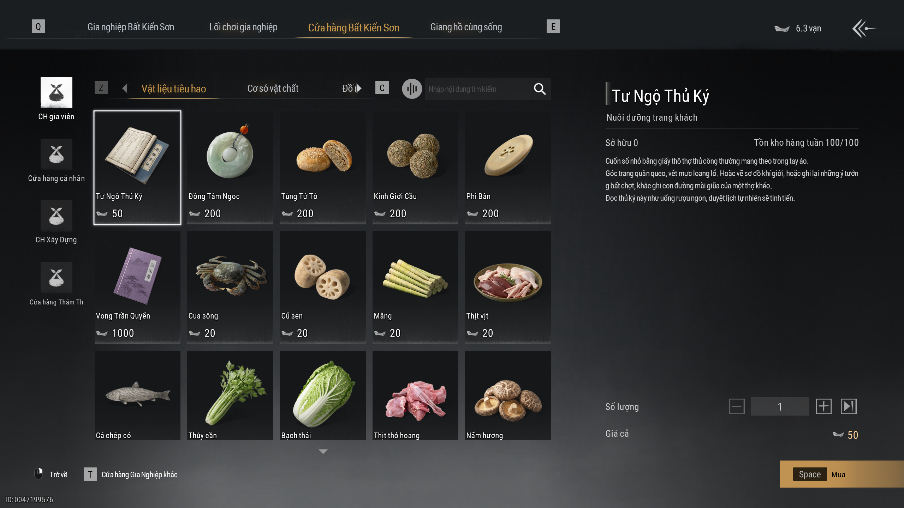
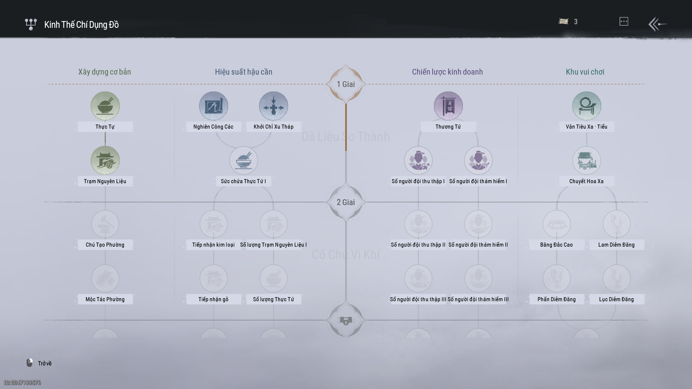
